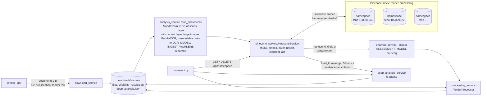

# One Pinecone namespace per tender

Every tender's documents are stored in a Pinecone namespace of their own, `tcno-<tcno>`, inside one shared index,
`tender-processing`. The eligibility check, re-checks and the deep analysis all retrieve their criteria from the
tender's namespace. This replaces `eligibility_criteria.md`, the file of LLM summaries that each tender folder used
to keep.

## Why namespaces, not an index per tender

An index per tender hits Pinecone's per-project index limit almost at once. Namespaces raise the ceiling by
several orders of magnitude while keeping each tender isolated:

| Plan | Indexes per project | Namespaces per index |
|---|---|---|
| Starter | 5 | 100 |
| Standard | 20 | 100,000 |
| Enterprise | 200 | 100,000 (1,000,000 per the 2026 changelog) |

Source: [Pinecone object limits](https://docs.pinecone.io/reference/api/database-limits/object-limits). 25 tenders
are already downloaded. That is 5× the Starter index limit, but a quarter of its namespace limit.

**Isolation.** Every read and write names the tender's namespace: upsert, query, fetch, delete. A query in one
namespace never returns another namespace's records. Each chunk also carries its `tcno` in its metadata.

## Architecture



**Names.** The index is `PINECONE_INDEX_NAME` (default `tender-processing`). The app creates it, serverless, on
first use and checks that its dimension matches `PINECONE_EMBED_DIMENSION`. Each tender's namespace is
`PINECONE_NAMESPACE_PREFIX + TCNO`, which is `tcno-100091540` by default. The app, the API, the UI and the logs
all use that name.

**Records in a namespace:**

| Record | ID | Metadata |
|---|---|---|
| chunk | `<sha1(source)[:16]>-<position>` | `record_type: chunk`, `tcno`, `source_file`, `document_type`, `chunk_id`, `chunk_index`, `overlap`, `created_at`, `text` |
| manifest | `__manifest__` | `record_type: manifest`, `status: building` or `complete`, `schema_version`, `embed_model`, `dimension`, `chunks`, `parts`, `payload` (sources and unreadable sources, as JSON), `created_at` |
| manifest part | `__manifest__-000`, ... | `record_type: manifest_part`, `payload`. Used only when the source list exceeds 30,000 characters, because Pinecone allows 40 KB of metadata per record |

Chunk IDs are derived from the source name and position, so the manifest alone gives every ID. `knowledge()`
can therefore read a whole tender back without listing records, and an upsert repeated after a failure
overwrites instead of duplicating. A namespace whose manifest is not `complete` is half-built and is never
trusted.

**Read-your-writes.** Pinecone serverless applies writes a few seconds after accepting them. Each upsert reports
the log position it was committed at (`lsn_committed`). Each search reports how far the namespace has caught up
(`lsn_reconciled`). Before writing the complete manifest, a build waits until searches have caught up with its
last chunk, and it waits again after writing the manifest. So a namespace marked complete is fully searchable.

**Embeddings.** Pinecone's hosted `llama-text-embed-v2` (1024 dimensions, up to 2,048 tokens per input, 96 inputs
per request), so `PINECONE_API_KEY` is the only credential needed.

## Processing flow

```mermaid
sequenceDiagram
    participant P as TenderProcessor
    participant TT as TenderTiger
    participant A as analysis_service
    participant S as PineconeService
    participant PC as Pinecone (tender-processing)
    participant L as Groq LLM
    P->>S: has_namespace(tcno, strict) (fails fast if Pinecone is down)
    P->>S: reset_namespace(tcno)
    S->>PC: create the index if missing, delete_all in tcno-<tcno>, upsert manifest {status: building}
    Note over S,PC: the namespace limit is checked here, before any download or OCR
    P->>TT: download documents (folder emptied first)
    P->>A: process_tender_files(folder, index, tender)
    A->>TT: pre-qualification text
    A->>A: read_documents (parallel; PaddleOCR a page at a time, vision pages 8 at a time)
    A->>S: ingest(tcno, documents, unreadable)
    loop batches of 96 chunks, INGEST_WORKERS at a time
        S->>PC: inference.embed (passage)
        S->>PC: upsert into tcno-<tcno> (50 per request)
    end
    S->>PC: query until reconciled with the last chunk's LSN
    S->>PC: upsert manifest {status: complete} (parts first), query until reconciled
    A->>S: retrieve(ASSESSMENT_QUERIES, manifest just written)
    S->>PC: fetch pinned TenderTiger chunks, embed queries, query tcno-<tcno> (top_k each)
    A->>L: assess_eligibility(excerpts by source, company profile)
    A-->>P: verdict, criteria, JV, index stats
```

Retrieval runs 13 searches over six kinds of requirement: eligibility, financial, technical, experience, JV and
compliance. The TenderTiger pre-qualification text and tender data are always sent in full. The searches then
take turns, each adding its next best chunk, until `RETRIEVAL_MAX_CHARS` is reached (60,000 characters, about 20k
tokens). The chunks are sent in document order. Neighbouring chunks are joined without their overlap, and `[…]`
marks a gap.

If the run fails before the manifest is complete, the processor deletes the namespace. A failed tender then
neither counts as indexed nor holds a place under the namespace limit.

## Re-check flow

`recheck_saved_criteria(tcno, index=...)` makes no download, no TenderTiger request and reads no file. It
retrieves `ASSESSMENT_QUERIES` from `tcno-<tcno>` and makes one LLM call. The unreadable sources come from the
manifest. Without a complete manifest it raises `NamespaceIncomplete`, and the processor falls back to the full
flow. Because a re-check never calls TenderTiger, it still runs while TenderTiger's firewall is blocking the app.

## Regeneration flow

1. `delete_namespace(tcno)`: see "Deleting a namespace" below.
2. `reset_namespace(tcno)` recreates it, marked as building. It fails here, before any download, if the plan has no room.
3. The folder is emptied and the documents are downloaded again.
4. The documents are read again, and `ingest` uploads the embeddings again and writes the complete manifest.
5. The criteria are retrieved and assessed.

## Deleting a namespace

Deleting a namespace is not ordered after the writes made to it. This was seen live: a namespace deleted seconds
after a build came back with the 2 records written last. `delete_namespace()` therefore takes these steps:

1. Empty the namespace with `delete_all`. That is applied in order after every earlier write.
2. Write a marker record, then wait until searches have caught up with the marker's LSN. Every write before it,
   including the `delete_all`, has then been applied.
3. Delete the namespace and wait until Pinecone reports it gone.
4. Check again after `settle_seconds` (5 s). If it came back, repeat, up to 3 times.

`DELETE /api/namespace/{tcno}` and regeneration therefore take a few seconds. In the live test, a build followed
at once by a delete left no namespace behind. In another run, a namespace came back once, was caught by step 4,
and was deleted again.

## Deep analysis

`DeepAnalysisRunner` calls `load_knowledge(index, tcno, result)`. It retrieves from `tcno-<tcno>`:

- Eligibility Criteria, Financial Requirements, Technical Requirements, Experience Requirements, JV Requirements
- Supporting Evidence: one search per criterion of the result

Each excerpt is given once, numbered `[E1]`, `[E2]` and so on. A guide follows, listing which excerpts answer each
kind of requirement and each criterion. Without a namespace, the agents work from the requirements the result
recorded, with a warning. Report version 3: `inputs.criteria_source` is `Pinecone namespace tcno-<tcno>`, and
`inputs.excerpts` counts the excerpts.

## API changes

| Change | Before (`eligibility_criteria.md`) | Now |
|---|---|---|
| `GET /api/tenders` row | `has_saved_criteria` | `has_indexed_criteria`: namespace `tcno-<tcno>` exists; false if Pinecone is unreachable |
| Result / progress item | `criteria_file` | `namespace` (`tcno-<tcno>` or null) |
| Full result | none | `index`: `{index, namespace, sources, chunks, embedding_tokens, retrieved_chunks, retrieved_characters}` |
| `POST /api/process-tenders` | `regenerate` re-reads the documents | `regenerate` deletes the namespace, re-downloads and rebuilds it |
| New | none | `GET /api/namespace/{tcno}`: existence, completeness, sources, chunk and record counts |
| New | none | `DELETE /api/namespace/{tcno}`: frees a place under the namespace limit; 409 while busy |
| Errors | none | `503` without `PINECONE_API_KEY`, `502` when Pinecone fails (`{"error": ...}` as before) |
| Deep analysis report | `version: 2` | `version: 3`, with `inputs.excerpts` |

Saved results lose `criteria_file` (or the `index_name` of the brief index-per-tender version) when they load, and
get `namespace`.

## Files changed

| File | Change |
|---|---|
| `services/pinecone_service.py` | **New.** `PineconeService`: shared index (`ensure_index`), namespace names, `has_namespace`, `reset_namespace`, `ingest`, `rebuild_namespace`, `delete_namespace`, chunking, embedding, batched parallel upserts, LSN read-your-writes, `query`, `retrieve`, `knowledge`, `manifest`, `status`, retries with backoff, quota detection |
| `services/analysis_service.py` | Criteria file and summarising removed. `read_documents` (parallel), `tender_data_text`, `ASSESSMENT_QUERIES`. `process_tender_files(folder, *, index, ...)` indexes then retrieves; `recheck_saved_criteria(tcno, *, index, ...)` retrieves only |
| `services/processing_service.py` | Namespace reserved before download, regenerate deletes the namespace, half-built namespaces rebuilt and failed builds cleaned up, `namespace` field, `delete_namespace()`, Pinecone errors explained |
| `services/deep_analysis_service.py` | `load_knowledge()` from the namespace replaces the criteria file; report version 3 |
| `routes/api.py` | `has_indexed_criteria`, `GET` / `DELETE /api/namespace/{tcno}`, `VectorStoreError` handler |
| `app.py`, `config.py`, `.env.example` | Service from config; `PINECONE_API_KEY`, `PINECONE_INDEX_NAME`, `PINECONE_NAMESPACE_PREFIX=tcno-` and tuning settings |
| `ext.py` | The assessment prompt speaks of retrieved excerpts |
| `static/js/app.js`, `templates/index.html` | `has_indexed_criteria` / `namespace`, and wording |
| `utils/logging_setup.py` | Quiets the Pinecone SDK's per-request INFO logs |
| `scripts/migrate_to_pinecone.py` | **New.** One-off migration |
| `pinecone_fake.py`, `test_pinecone_service.py`, `test_app.py` | In-memory Pinecone (namespaces, LSNs, quotas), 30 service tests, analysis and API tests on namespaces |
| `requirements.txt` | `pinecone==10.3.0` |

## Migration plan

1. **Deploy** with `PINECONE_API_KEY` in `.env` and stop the app. The shared index already exists in the project
   (made by the live test, empty). Otherwise the first build creates it.
2. **Dry run:** `python scripts/migrate_to_pinecone.py --dry-run`, then run it for real. It reads the documents
   already on disk and takes the pre-qualification text from the old `eligibility_criteria.md`, so no TenderTiger
   request is made. It builds each namespace, then deletes the `.md` file. A tender with no readable text keeps
   its file. Scanned PDFs are OCR'd again: PaddleOCR locally, and Groq tokens for their unsure and table pages. Complete namespaces are skipped, so the script
   can be re-run. It stops cleanly at the namespace limit.
3. **Start the app.** Saved results load with `namespace` filled in. A tender that was not migrated is downloaded
   and indexed the next time it is checked.
4. **Roll back** by checking out the previous commit. Run the migration with `--keep-criteria-files` if rollback
   matters, because the old version reads those files.

## Risks and edge cases

| Risk | Impact | Mitigation |
|---|---|---|
| **Namespace limit** (100 per index on Starter) | New tenders fail with "The Pinecone namespace limit is reached" | The namespace is reserved before the download, so no download or OCR is wasted. `DELETE /api/namespace/{tcno}` frees a place, and the migration stops cleanly. Above 100 tenders on Starter, delete the namespaces of closed or dropped tenders, or move to Standard (100,000) |
| **Shared index** | All tenders depend on one index | Isolation is per namespace, and no operation crosses namespaces. Deleting the index loses every tender's namespace, but the app recreates the index on the next build and tenders re-index when next checked |
| **Namespace resurrection** after a delete | A deleted tender comes back with stale records | Empty first with `delete_all`, wait on a marker's LSN, delete, then re-check and retry (see above) |
| **Eventual consistency** | Retrieval could miss fresh chunks | The build waits on LSNs, before and after the manifest. Without LSN headers it falls back to record counts and fetches. The first retrieval uses the manifest just written |
| **Recall.** Retrieval sends excerpts, where the old pipeline summarised every page | An unusually worded criterion may be missed | 13 searches over 6 kinds of requirement; the pre-qualification text is always included; 60k-character budget. Tune `ASSESSMENT_QUERIES`, `RETRIEVAL_TOP_K` and `RETRIEVAL_MAX_CHARS`, and compare verdicts on a sample of tenders |
| **Partial failure** | Half-built namespace | A failed run deletes it. One left by a crash is never trusted and is rebuilt on the next check. Calls are retried with backoff on 408/429/5xx and network errors |
| **Pinecone unreachable** | Checks fail | The tender list still loads (`has_indexed_criteria` false; the failure is cached for 30 s). Processing fails fast, before any download |
| **Rate limits** (embedding, upserts, `describe_namespace`) | Slower ingestion | Retries with jitter on top of the SDK's own; workers capped by `INGEST_WORKERS`; PaddleOCR one page at a time per process, vision pages `OCR_CONCURRENCY` at a time |
| **Manifest size** | Hundreds of files exceed 40 KB of metadata | Split over part records; a missing part means incomplete, never half-read |
| **Changing the embedding model or dimension** | The index's dimension is fixed | The app refuses a mismatched index with a clear error. Set a new `PINECONE_INDEX_NAME` and run `migrate_to_pinecone.py --force` |
| **Migration** deletes `eligibility_criteria.md` | Hand edits to those files are lost | The file is kept when nothing could be indexed, and `--keep-criteria-files` keeps all of them |
| **TCNOs with spaces or non-ASCII** | Invalid namespace name | Refused with a clear error (Pinecone allows printable ASCII up to 512 characters) |
