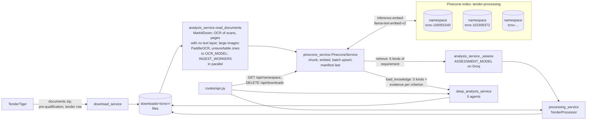

# One Pinecone namespace per tender

Every tender's documents are stored in a Pinecone namespace of their own, `tcno-<tcno>`, inside one shared index,
`tender-processing`. The eligibility check, re-checks and the deep analysis all retrieve their criteria from the
tender's namespace. This replaces `eligibility_criteria.md`, the file of LLM summaries that each tender folder used
to keep.

## Why namespaces, not an index per tender

An index per tender hits Pinecone's per-project index limit almost at once. Namespaces raise the ceiling by
several orders of magnitude while keeping each tender isolated:

| Plan | Indexes per project | Namespaces per index |
|---|---|---|
| Starter | 5 | 100 |
| Standard | 20 | 100,000 |
| Enterprise | 200 | 100,000 (1,000,000 per the 2026 changelog) |

Source: [Pinecone object limits](https://docs.pinecone.io/reference/api/database-limits/object-limits). 25 tenders
are already downloaded. That is 5× the Starter index limit, but a quarter of its namespace limit.

**Isolation.** Every read and write names the tender's namespace: upsert, query, fetch, delete. A query in one
namespace never returns another namespace's records. Each chunk also carries its `tcno` in its metadata.

## Architecture



**Names.** The index is `PINECONE_INDEX_NAME` (default `tender-processing`). The app creates it, serverless, on
first use, with the metric `PINECONE_METRIC` (default `dotproduct`, see Hybrid retrieval below), and checks that
its dimension matches `PINECONE_EMBED_DIMENSION`. Each tender's namespace is
`PINECONE_NAMESPACE_PREFIX + TCNO`, which is `tcno-100091540` by default. The app, the API, the UI and the logs
all use that name.

**Records in a namespace:**

| Record | ID | Metadata |
|---|---|---|
| chunk | `<sha1(source)[:16]>-<position>` | `record_type: chunk`, `tcno`, `source_file`, `document_type`, `chunk_id`, `chunk_index`, `overlap`, `created_at`, `text`; `section`, `sections` and `section_titles` (the document sections it is in); sparse values on a `dotproduct` index |
| manifest | `__manifest__` | `record_type: manifest`, `status: building` or `complete`, `kept` (building, its chunks kept for a regenerate), `schema_version` (3), `embed_model`, `dimension`, `chunk_size`, `chunk_overlap`, `hybrid` (the chunks hold sparse values), `chunks`, `parts`, `payload` (sources with their chunk counts, SHA-256s and section headings, and unreadable sources, as JSON), `created_at` |
| manifest part | `__manifest__-000`, ... | `record_type: manifest_part`, `payload`. Used only when the source list exceeds 30,000 characters, because Pinecone allows 40 KB of metadata per record |

Chunk IDs are derived from the source name and position, so the manifest alone gives every ID. `knowledge()`
can therefore read a whole tender back without listing records, and an upsert repeated after a failure
overwrites instead of duplicating. A namespace whose manifest is not `complete` is half-built and is never
trusted.

**Read-your-writes.** Pinecone serverless applies writes a few seconds after accepting them. Each upsert reports
the log position it was committed at (`lsn_committed`). Each search reports how far the namespace has caught up
(`lsn_reconciled`). Before writing the complete manifest, a build waits until searches have caught up with its
last chunk, and it waits again after writing the manifest. So a namespace marked complete is fully searchable.

**Embeddings.** Pinecone's hosted `llama-text-embed-v2` (1024 dimensions, up to 2,048 tokens per input, 96 inputs
per request), so `PINECONE_API_KEY` is the only credential needed.

## Processing flow

```mermaid
sequenceDiagram
    participant P as TenderProcessor
    participant TT as TenderTiger
    participant A as analysis_service
    participant S as PineconeService
    participant PC as Pinecone (tender-processing)
    participant L as Groq LLM
    P->>S: has_namespace(tcno, strict) (fails fast if Pinecone is down)
    P->>S: reset_namespace(tcno)
    S->>PC: create the index if missing, delete_all in tcno-<tcno>, upsert manifest {status: building}
    Note over S,PC: the namespace limit is checked here, before any download or OCR
    P->>TT: download documents (they replace the folder once all are in)
    P->>A: process_tender_files(folder, index, tender)
    A->>TT: pre-qualification text
    A->>A: read_documents (parallel; PaddleOCR a page at a time, vision pages 8 at a time)
    A->>S: ingest(tcno, documents, unreadable)
    loop batches of 96 chunks, INGEST_WORKERS at a time
        S->>PC: inference.embed (passage)
        S->>PC: upsert into tcno-<tcno> (50 per request)
    end
    S->>PC: query until reconciled with the last chunk's LSN
    S->>PC: upsert manifest {status: complete} (parts first), query until reconciled
    A->>S: retrieve(ASSESSMENT_QUERIES, manifest just written)
    S->>PC: fetch pinned TenderTiger chunks, embed queries, query tcno-<tcno> (top_k each)
    A->>L: assess_eligibility(excerpts by source, company profile)
    A-->>P: verdict, criteria, JV, index stats
```

Retrieval runs 2 section searches and 13 searches over six kinds of requirement: eligibility, financial,
technical, experience, JV and compliance. The TenderTiger pre-qualification text and tender data are always sent in
full. The qualification sections come next, whole, chosen by a model from the documents' headings or else by the
section searches (hierarchical retrieval, below). The searches then take turns,
each adding its next best chunk, until `RETRIEVAL_MAX_CHARS` is reached (60,000 characters, about 20k tokens). The
chunks are sent in document order. Neighbouring chunks are joined without their overlap, and `[…]` marks a gap.

**Adaptive retrieval.** A search keeps its `RETRIEVAL_TOP_K` matches only down to `RETRIEVAL_SCORE_FLOOR` (0.85)
times its best score, and none under `RETRIEVAL_MIN_SCORE` (0.2 cosine; times the dense weight in a hybrid search),
two at least. Calibrated on the 35 namespaces in the index on 13 Nov 2026 (every assessment query's top 20 matches,
replayed through the round robin): 24% less text at the defaults (8 per query, 60,000 characters), 9% at 5 and
30,000. The best match of a kind the tender does not cover scores about 0.1, of one it covers 0.35 to 0.5.

**Hierarchical retrieval.** Each chunk records the sections it is in, as ranges of its source's chunks
(`sections: ["14-15", "12-19"]`, smallest first, with `section_titles`), told from the document's headings by
`document_sections.py`: a major section (a part, section, annexure, or a short line in capitals) runs to the next
major heading and holds the minor ones (numbered or lettered clause headings in capitals or title case) after it;
running headers and footers (lines on three pages or more), table rows, contents lines and OCR's `## Page n` are
never headings.

The sections to take whole are chosen in one of two ways, within `RETRIEVAL_SECTION_SHARE` (half) of the budget:

1. **By their headings.** The manifest lists every source's sections (`contents`: tier, first and last chunk,
   characters, title; not for the TenderTiger texts). The check sends `SECTION_MODEL` (`openai/gpt-oss-20b`,
   reasoning `low`) the headings of every source but the BOQ, one line each, minor ones indented under their major
   one, with an ID (`S12`) on each section that fits the share and none on one too long to take whole. The model
   answers with up to 6 IDs, best first, or `none` when no heading names qualification criteria
   (`choose_sections()` in `utils/llm.py`). Each section it chose is fetched by its chunk IDs and taken while it
   fits. `whole_sections` marks them `picked_by: model`.
2. **By search votes**, when the model chose none, failed, or the namespace was built before headings were listed:
   the two `QUALIFICATION_SECTION` searches vote, with their matches' scores, for every section a match is in that
   fits, so a major section gathers the votes of its minor ones. The winner is fetched and sent whole, and a second,
   non-overlapping section too if its votes are within the score floor of the first's (`picked_by: search`).

The headings listing is small: on the 38 tenders in `downloads/` on 18 Nov 2026 (text layers only), a median of
about 220 tokens, 1,400 at the 90th percentile and 3,200 at most (a tender with 214 sections). A listing over
`SECTION_LIST_MAX_CHARS` (16,000 characters) is sent with its major sections only, and not at all if still over.
Groq limits tokens per minute per model, so the call to `gpt-oss-20b` leaves `ASSESSMENT_MODEL`'s budget to the
check. Its tokens are counted under `assessment`. Live on 8 of those tenders, the model chose the qualification
clauses on 5 (for example `(A) QUALIFYING CRITERIA`, `(i) Financial Eligibility`, `(ii) Technical Eligibility`,
`(B) JOINT VENTURE BID`) and answered `none` on 3 whose headings name no criteria, leaving those to the votes.

A deep analysis takes again the sections the check took on the model's word (matched by source and chunks), without
asking the model, so the agents read what the check read. On the LIC Suri NIT (112,772 characters), the major
section holding "A. WORKS EXPERIENCE" to "D. DISQUALIFICATION" is 7,587 characters. Namespaces built before (schema
2) have no sections, so retrieval skips this step for them.

**Hybrid retrieval.** On a `dotproduct` index, every chunk also holds sparse values (`sparse_encoder.py`): the
hashed terms of its section title and text, weighted 1 + ln(count) and twice that for a figure, at unit length.
Amounts are one term however written (`Rs. 25 lakh`, `₹ 25,00,000`, `0.25 crore`: `amt:2500000`), and so are
clause references (`clause 4.2.1`, a bare `4.2.1` heading; `Annexure-III` and `Annexure 3`), percentages and
financial years (`FY 2023-2024`: `fy:2023-24`). Words every tender uses are stop words in place of IDF. A search's
dense vector is scaled by `RETRIEVAL_HYBRID_ALPHA` (0.75) and its sparse one by the rest, so its score is a
weighted sum of two cosines. Dense vectors are scaled to unit length, so `dotproduct` ranks them as `cosine` did.
An index keeps the metric it was made with: on a `cosine` index (the one made before this change), sparse values
are neither written nor sent, and a warning says so once. To switch, set a new `PINECONE_INDEX_NAME`; each tender
is indexed into it the next time it is checked, its texts and vectors coming from the cache.

If the run fails before the manifest is complete, the processor deletes the namespace. A failed tender then
neither counts as indexed nor holds a place under the namespace limit.

## Re-check flow

`recheck_saved_criteria(tcno, index=...)` makes no download, no TenderTiger request and reads no file. It
retrieves `ASSESSMENT_QUERIES` from `tcno-<tcno>` and makes one LLM call. The unreadable sources come from the
manifest. Without a complete manifest it raises `NamespaceIncomplete`, and the processor falls back to the full
flow. Because a re-check never calls TenderTiger, it still runs while TenderTiger's firewall is blocking the app.

## Regeneration flow

Regenerating keeps what has not changed, in the namespace and in the cache:

1. `reset_namespace(tcno, keep=True)`. A complete namespace of the current schema, embedding model and dimension
   keeps its chunks: its manifest is rewritten as `building` and `kept`, so it no longer counts as complete. Any
   other is emptied. It fails here, before any download, if the plan has no room. The manifest write is waited on
   until searches see it, so `ingest` reads this manifest back, never the one before.
2. The documents are downloaded again; they replace the folder only once all are in, so a failed download leaves
   the last ones.
3. The documents are read again. A file unchanged to the byte comes from the text cache; a page or image whose
   rendered image was read before comes from the page cache (a file whose OCR failed on some pages, or a reissued
   scan, has only the other pages read).
4. `ingest` compares each source's SHA-256 (of its text, type and everything else that shapes its records: schema,
   section and sparse versions, chunk size and overlap) with the kept manifest's. Before changing anything, it marks
   the manifest `building` without `kept`, so a build that fails from here on is never kept, only rebuilt. It then
   deletes the chunks of sources gone or grown shorter (and manifest parts no longer needed), upserts the changed
   and new sources (their vectors from the cache when their chunks were embedded before), and writes the complete
   manifest. Unchanged sources are neither embedded nor upserted. The result's `index` counts `upserted`,
   `kept_sources` and `deleted`.
5. The criteria are retrieved and assessed.

If a step fails, the processor deletes the namespace, as it has no complete manifest; the next check reads the
documents again. Before this change, regenerating deleted the namespace first and upserted every chunk again.

## Deleting a namespace

Deleting a namespace is not ordered after the writes made to it. This was seen live: a namespace deleted seconds
after a build came back with the 2 records written last. `delete_namespace()` therefore takes these steps:

1. Empty the namespace with `delete_all`. That is applied in order after every earlier write.
2. Write a marker record, then wait until searches have caught up with the marker's LSN. Every write before it,
   including the `delete_all`, has then been applied.
3. Delete the namespace and wait until Pinecone reports it gone.
4. Check again after `settle_seconds` (5 s). If it came back, repeat, up to 3 times.

Deleting a tender (`DELETE /api/downloads/{tcno}`) and regeneration therefore take a few seconds. In the live test, a build followed
at once by a delete left no namespace behind. In another run, a namespace came back once, was caught by step 4,
and was deleted again.

## Deep analysis

`DeepAnalysisRunner` calls `load_knowledge(index, tcno, result)`. It retrieves from `tcno-<tcno>`:

- Eligibility Criteria, Financial Requirements, Technical Requirements, Experience Requirements, JV Requirements
- Supporting Evidence: one search per criterion of the result

Each excerpt is given once, numbered `[E1]`, `[E2]` and so on. A guide follows, listing which excerpts answer each
kind of requirement and each criterion. Without a namespace, the agents work from the requirements the result
recorded, with a warning. Report version 3: `inputs.criteria_source` is `Pinecone namespace tcno-<tcno>`, and
`inputs.excerpts` counts the excerpts.

## API changes

| Change | Before (`eligibility_criteria.md`) | Now |
|---|---|---|
| `GET /api/tenders` row | `has_saved_criteria` | `has_indexed_criteria`: namespace `tcno-<tcno>` exists; false if Pinecone is unreachable |
| Result / progress item | `criteria_file` | `namespace` (`tcno-<tcno>` or null) |
| Full result | none | `index`: `{index, namespace, sources, chunks, embedding_tokens, retrieved_chunks, retrieved_characters}` |
| `POST /api/process-tenders` | `regenerate` re-reads the documents | `regenerate` re-downloads and re-reads the documents and upserts only the sources that changed |
| New | none | `GET /api/namespace/{tcno}`: existence, completeness, sources, chunk and record counts |
| New, since removed | none | `DELETE /api/namespace/{tcno}` freed a place under the namespace limit; a namespace now goes only with its tender (`DELETE /api/downloads/{tcno}`) |
| Errors | none | `503` without `PINECONE_API_KEY`, `502` when Pinecone fails (`{"error": ...}` as before) |
| Deep analysis report | `version: 2` | `version: 3`, with `inputs.excerpts` |

Results saved in files by an older version lost `criteria_file` (or the `index_name` of the brief index-per-tender
version) when an import script, since removed, moved them into the database.

## Files changed

| File | Change |
|---|---|
| `services/pinecone_service.py` | **New.** `PineconeService`: shared index (`ensure_index`), namespace names, `has_namespace`, `reset_namespace`, `ingest`, `rebuild_namespace`, `delete_namespace`, chunking, embedding, batched parallel upserts, LSN read-your-writes, `query`, `retrieve`, `knowledge`, `manifest`, `status`, retries with backoff, quota detection |
| `services/analysis_service.py` | Criteria file and summarising removed. `read_documents` (parallel), `tender_data_text`, `ASSESSMENT_QUERIES`. `process_tender_files(folder, *, index, ...)` indexes then retrieves; `recheck_saved_criteria(tcno, *, index, ...)` retrieves only |
| `services/processing_service.py` | Namespace reserved before download, regenerate deletes the namespace, half-built namespaces rebuilt and failed builds cleaned up, `namespace` field, `delete_namespace()`, Pinecone errors explained |
| `services/deep_analysis_service.py` | `load_knowledge()` from the namespace replaces the criteria file; report version 3 |
| `routes/api.py` | `has_indexed_criteria`, `GET /api/namespace/{tcno}` (and a `DELETE`, since removed), `VectorStoreError` handler |
| `app.py`, `config.py`, `.env.example` | Service from config; `PINECONE_API_KEY`, `PINECONE_INDEX_NAME`, `PINECONE_NAMESPACE_PREFIX=tcno-` and tuning settings |
| `ext.py` (now `utils/llm.py`) | The assessment prompt speaks of retrieved excerpts |
| `static/js/app.js`, `templates/index.html` | `has_indexed_criteria` / `namespace`, and wording |
| `utils/logging_setup.py` | Quiets the Pinecone SDK's per-request INFO logs |
| `scripts/migrate_to_pinecone.py` | **New.** One-off migration; since removed, once it had run |
| `tests/pinecone_fake.py`, `tests/test_pinecone_service.py`, `tests/test_app.py` | In-memory Pinecone (namespaces, LSNs, quotas), 30 service tests, analysis and API tests on namespaces |
| `requirements.txt` | `pinecone==10.3.0` |

## Migration plan

1. **Deploy** with `PINECONE_API_KEY` in `.env` and stop the app. The shared index already exists in the project
   (made by the live test, empty). Otherwise the first build creates it.
2. **Dry run:** `python scripts/migrate_to_pinecone.py --dry-run`, then run it for real (the script has since been
   removed: a tender not migrated is indexed when next checked). It reads the documents
   already on disk and takes the pre-qualification text from the old `eligibility_criteria.md`, so no TenderTiger
   request is made. It builds each namespace, then deletes the `.md` file. A tender with no readable text keeps
   its file. Scanned PDFs are OCR'd again: PaddleOCR locally, and Groq tokens for their unsure and table pages. Complete namespaces are skipped, so the script
   can be re-run. It stops cleanly at the namespace limit.
3. **Start the app.** A tender that was not migrated is downloaded
   and indexed the next time it is checked.
4. **Roll back** by checking out the previous commit. Run the migration with `--keep-criteria-files` if rollback
   matters, because the old version reads those files.

## Risks and edge cases

| Risk | Impact | Mitigation |
|---|---|---|
| **Namespace limit** (100 per index on Starter) | New tenders fail with "The Pinecone namespace limit is reached" | The namespace is reserved before the download, so no download or OCR is wasted. Deleting a closed tender (Closed tenders) frees a place, and the migration stops cleanly. Above 100 tenders on Starter, delete the namespaces of closed or dropped tenders, or move to Standard (100,000) |
| **Shared index** | All tenders depend on one index | Isolation is per namespace, and no operation crosses namespaces. Deleting the index loses every tender's namespace, but the app recreates the index on the next build and tenders re-index when next checked |
| **Namespace resurrection** after a delete | A deleted tender comes back with stale records | Empty first with `delete_all`, wait on a marker's LSN, delete, then re-check and retry (see above) |
| **Eventual consistency** | Retrieval could miss fresh chunks | The build waits on LSNs, before and after the manifest. Without LSN headers it falls back to record counts and fetches. The first retrieval uses the manifest just written |
| **Recall.** Retrieval sends excerpts, where the old pipeline summarised every page | An unusually worded criterion may be missed | 13 searches over 6 kinds of requirement; the pre-qualification text is always included; 60k-character budget. Tune `ASSESSMENT_QUERIES`, `RETRIEVAL_TOP_K` and `RETRIEVAL_MAX_CHARS`, and compare verdicts on a sample of tenders |
| **Partial failure** | Half-built namespace | A failed run deletes it. One left by a crash is never trusted and is rebuilt on the next check. Calls are retried with backoff on 408/429/5xx and network errors |
| **Pinecone unreachable** | Checks fail | The tender list still loads (`has_indexed_criteria` false; the failure is cached for 30 s). Processing fails fast, before any download |
| **Rate limits** (embedding, upserts, `describe_namespace`) | Slower ingestion | Retries with jitter on top of the SDK's own; workers capped by `INGEST_WORKERS`; PaddleOCR one page at a time per process, vision pages `OCR_CONCURRENCY` at a time |
| **Manifest size** | Hundreds of files exceed 40 KB of metadata | Split over part records; a missing part means incomplete, never half-read |
| **Changing the embedding model or dimension** | The index's dimension is fixed | The app refuses a mismatched index with a clear error. Set a new `PINECONE_INDEX_NAME` and run `migrate_to_pinecone.py --force` |
| **Migration** deletes `eligibility_criteria.md` | Hand edits to those files are lost | The file is kept when nothing could be indexed, and `--keep-criteria-files` keeps all of them |
| **TCNOs with spaces or non-ASCII** | Invalid namespace name | Refused with a clear error (Pinecone allows printable ASCII up to 512 characters) |
